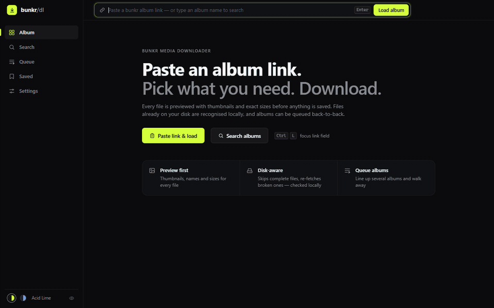
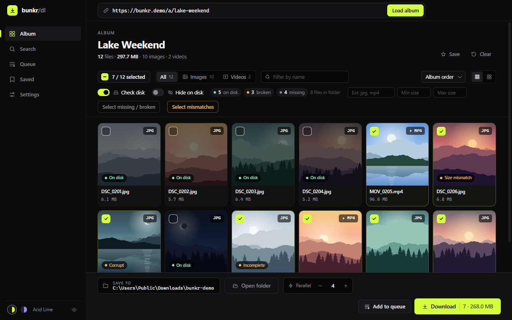
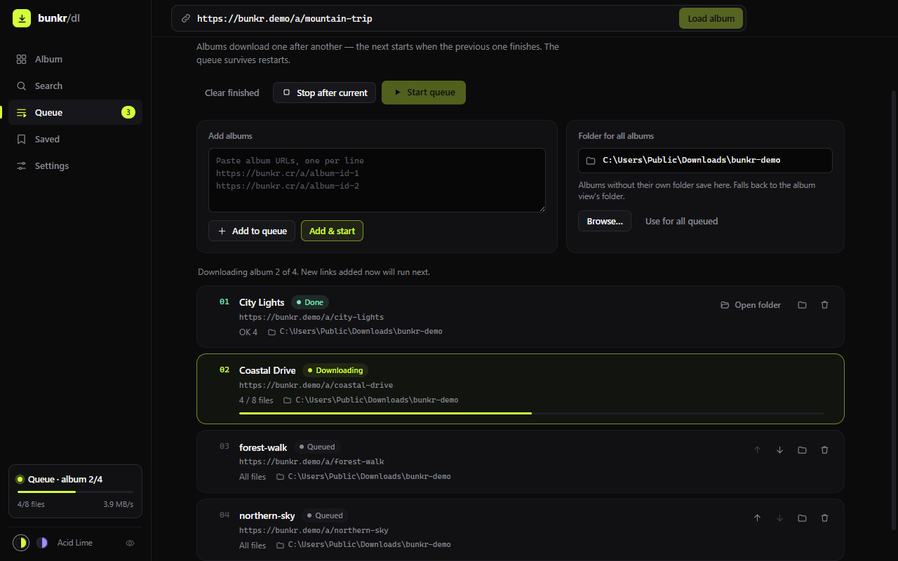
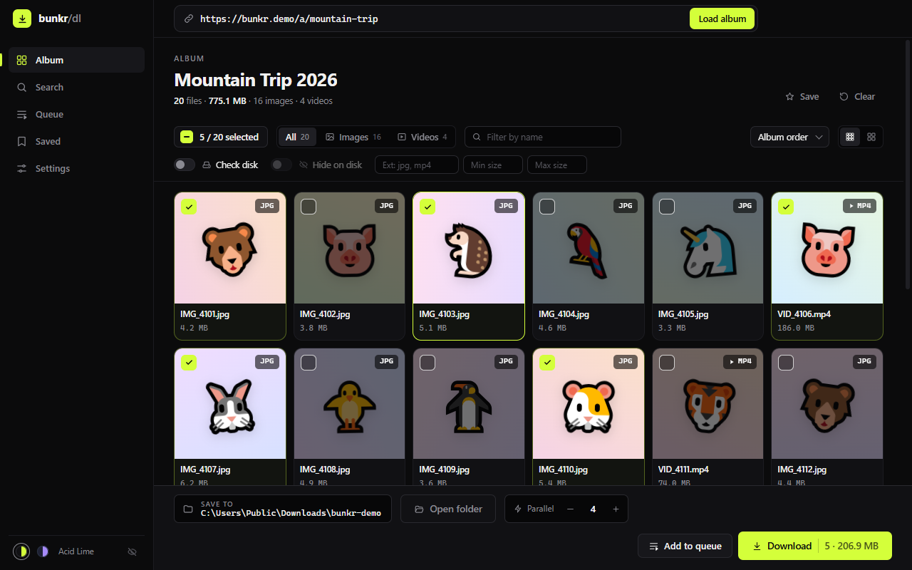

# bunkr-download

A bunkr media downloader with both a **desktop UI** (Electron) and a **CLI**.

**Download:** get `bunkr-download-<version>-portable.exe` (Windows, x64, nothing to install) or the Chrome extension zip from the [latest release](../../releases/latest).

> Not affiliated with Bunkr. Download only content you own or are allowed to download — see [Disclaimer](#disclaimer).



## Screenshots

The pictures are recorded from the real app against a local demo album of generated landscapes.

**Check disk** — see what is already in the folder, what is broken and what is missing, and select only what needs downloading.



**Download queue** — line up several albums; they download one after another.



**Discreet view** — previews become cute animals (or blur, scenery, file icons) when other people can see your screen.



## Features

### Desktop UI (Electron)
- Paste an album URL → **load preview** with thumbnails, names and sizes of every file (skeleton grid + progress while previews resolve).
- **Click a card to select it**, **Shift+click** to select a range, **Select all** (or `Ctrl+A`) for everything visible.
- **Filter the grid** by type (Images / Videos / Other), by name (`Ctrl+F`), sort by name / size / type, and switch thumbnail size.
- Pick the download folder with a **native folder picker** (the “Save to” chip in the bottom dock).
- Optional **Check disk** — scans the album folder on disk only, badges files as On disk / Incomplete / Corrupt / Size mismatch, and can auto-select only missing or broken ones.
- **Hide on disk** hides files marked On disk after a check. Missing or damaged files remain visible. Filters apply to actions: Select all, Download and Add to queue use only visible files, and the toolbar warns when selected files are hidden by a filter.
- Live **per-file and overall progress** with bytes, speed and ETA; a mini progress card in the sidebar stays visible from every screen.
- **Album search** — find albums by title instead of pasting a link. Search runs on [balbums.st](https://balbums.st/) (bunkr itself has no public album search) with its match modes (Broad / Strict / Fuzzy / Substring / Exact phrase), sort order and page size. Results show a thumbnail and file count; **Open** loads the album here, and each result can be queued or saved in one click. Typing plain words (not a link) into the link field searches too.
- **Saved albums** — bookmark an album URL with an optional note and load it later (recent ones also appear on the start screen).
- **Download queue** — paste several album URLs; they download one after another. The next album starts when the previous one finishes. You can add more while a run is in progress. Choose one folder for the whole queue, or a different folder per album.
- **Re-download size mismatches** — a setting (and “Select mismatches”) to re-download every file whose size does not match.
- **Name cipher** — replace a word in the album folder and file names that the app creates (or fill a random replacement). Optionally swap every sensitive word (from the Discreet view lists) for a neutral one in names on disk.
- **Discreet view** — a quiet privacy screen, toggled with `Ctrl+Shift+H` or a small eye in the sidebar (no banner, no label). Previews become file-type icons, a blur, cute animals, generated scenery or abstract gradients; covered previews are not even downloaded. Sensitive words in file names, album titles, search results, saved albums and the queue become neutral words (`hot_sex_tape.mp4` → `hot_pine_tape.mp4`), dots, or camera-style names (`VID_0001.mp4`). You choose the built-in word lists (explicit terms, anatomy, genres & tags, sites & platforms — English and Russian) and add your own. Hold **Alt** to peek at one card; optionally blur the whole window whenever it loses focus (covers taskbar and Alt+Tab previews).
- **Two themes** — *Acid Lime* (editorial black) and *Midnight Lavender*; switch in the sidebar or in Settings. The choice is remembered.
- **Stop and resume** — **Stop** interrupts the download but keeps partial `.part` files; the next Download continues them with an HTTP Range request instead of starting over. After a run, **Retry failed** downloads only the files that failed.
- **Extension and size filters** in the album toolbar (`jpg, mp4`, min `2M`, max `1.5G`). Files of unknown size or extension are never hidden by them.
- **Downloads settings** — retries per file, speed limit (MB/s), proxy (`http://`, `https://`, `socks5://`), what to do while Bunkr is under maintenance, and a free-disk-space check before starting.
- Files saved to `<output>/<album-name>/`; two different files with the same name become `name.ext` and `name (1).ext` instead of overwriting each other.
- Failed URLs are appended to `<output>/errors.log`.

### CLI
- Downloads multiple files **concurrently** from an album (configurable concurrency).
- **Reliable transfers** — retries with exponential backoff on network errors, `429` (honouring `Retry-After`) and `5xx`; interrupted files resume where they stopped; error pages are never saved as files; each finished file is checked against the expected size before it is kept.
- **Batch downloading** via a list of URLs (passed as args or via `--input` file; `#` starts a comment).
- **Selective downloading** by file name (substring or `/regex/`), extension (`--ext`) and size (`--min-size` / `--max-size`).
- **Dry run** — `--dry-run` lists what would be downloaded (name, size, on-disk status) without downloading; `--export <file>` writes the page URLs that passed the filters.
- **Skip already-complete files** with `--skip-existing` (re-downloads empty, size-mismatched, or corrupt locals).
- **Network control** — `--proxy`, `--limit-rate`, `--max-retries`.
- **Bunkr maintenance** is detected; files wait and retry (`--maintenance backoff`, default) or are skipped (`--maintenance skip`).
- **Disk space check** before each album (`--no-disk-check` to bypass).
- **Ctrl+C** stops cleanly and keeps partial files for the next run.
- **Custom download location** with `--output`.
- **Progress indication** per file (byte-level progress bars) plus summary counts.
- **Organized storage** — album files are saved under `<output>/<album-name>/`.
- **Error logging** — failed URLs are appended to `<output>/errors.log` (or a custom `--error-log`).
- **Album search** — `search <words>` lists matching albums (title, file count, URL); `--urls` prints only URLs for an `--input` file.

## Requirements

- Node.js >= 20 (to run from source or use the CLI)
- Or no Node at all: download `bunkr-download-<version>-portable.exe` from the [Releases page](../../releases) (Windows, x64).

## Install

```bash
npm install
```

### Build the portable Windows app

```bash
npm run dist          # → dist/bunkr-download-<version>-portable.exe
```

The portable build is not code-signed, so Windows SmartScreen may warn on first launch. It also uses the default Electron icon until an application icon is added.

### Develop

```bash
npm test      # node:test suite (mock servers; never touches the real bunkr)
npm run lint
npm run readme-media  # re-record the README GIF and screenshots in assets/
```

`readme-media` runs the desktop app against a local demo site (`https://bunkr.demo`, only inside that run) with generated pictures. It needs ffmpeg on PATH, openssl (Git for Windows includes it) and a free port 443; the app window shows for about a minute, so leave it alone while it records.

## Desktop UI

```bash
npm start
```

The window has a sidebar (**Album**, **Search**, **Queue**, **Saved**, **Settings**), the album link field at the top, and a dock at the bottom of the Album screen with the folder, parallel downloads and the Download button.

Then:
1. Paste an album URL (e.g. `https://bunkr.cr/a/<id>`) into the link field and press **Enter** (or **Load album**). On the start screen, **Paste link & load** does both from the clipboard.
   - Don't have a link? Open **Search** (or press `Ctrl+K`, or just type an album name into the link field) and search album titles. Pick a match mode, sort and page size; click a result (or **Open**) to load it. The queue and star buttons on a result add it to the queue or to Saved. The search site can be changed in **Settings → Album search** if it moves to a new domain.
2. The grid fills with thumbnail cards. Click a card to toggle it; **Shift+click** selects a range; **Select all** toggles everything visible.
3. Narrow the grid with the type filter (Images / Videos / Other), the name filter, and the sort menu if needed.
4. Click the **Save to** chip in the dock and choose a directory.
5. Adjust **Parallel** downloads with − / + if needed (default 4).
6. (Optional) Turn on **Check disk** in the toolbar — the app scans `<output>/<album-name>/` on your machine only, marks complete/broken files, and selects missing/broken ones. Use **Select missing / broken** anytime to re-apply that selection, and **Hide on disk** to hide complete files.
7. (Optional) **Settings → Re-download size mismatches** controls whether files tagged Size mismatch are re-downloaded. **Select mismatches** in the toolbar picks only those files.
8. (Optional) **Settings → Name cipher**: turn it on, type the word to hide, and either type a replacement or click **Random**. The album folder and created file names use the replacement (case-insensitive substring). Check disk looks in the ciphered folder.
9. Click **Save** in the album header to bookmark the URL. Open **Saved** to load, add notes, queue, or remove bookmarks.
10. Click **Download** (it shows the selected count and size). Overall progress, speed and ETA appear in the dock; **Per-file** expands the per-file list. **Open folder** next to the Save to chip opens the album's folder in Explorer / Finder (or the download folder if nothing from this album is on disk yet).
11. To download several albums without waiting on each one: open **Queue**, paste album URLs (one per line), pick a folder, and click **Add & start** (or **Start queue**). Albums run sequentially. Use **Add to queue** in the dock to enqueue only the selected files of the open album. **Stop after current** finishes the album in progress, then pauses. The queue is remembered between app restarts.
    - **Folder for all albums** in the Queue screen is the default save location for every queued album (falls back to the Album screen's folder if empty).
    - The folder icon on a queue row sets a folder for that album only. **Use default** puts it back on the shared folder. **Use for all queued** clears per-album folders so everything follows the queue folder.
    - **Open folder** on a finished queue row opens that album's folder.
12. Switch themes with the two swatches at the bottom of the sidebar, or in **Settings → Appearance**.

Shortcuts: `Ctrl+L` focus the link field · `Ctrl+K` search albums · `Ctrl+F` filter files by name · `Ctrl+A` select / deselect all visible · `Esc` back to the Album screen.

### Notes on the UI

- Preview may take a few seconds for large albums: the album grid supplies working thumbs for images and videos (mp4/mkv/webm/…), then each file page is fetched to refine the original filename and exact size (from bunkr's `Debug:` comment). Broken `og:image` URLs (e.g. `UUID.jpg.png`) are normalized to the real thumb path. Concurrency is intentionally low (2) here to avoid rate limits.
- Thumbnails load directly from the bunkr/CDN with `Referrer-Policy: no-referrer`, so your album URL is **not** leaked to the CDN.
- **Check disk** is privacy-first: it only reads the chosen local folder (file names, sizes, a few header bytes). Nothing is uploaded or hashed into a cloud index.
- **Album search** sends only your search words to the search site (balbums.st by default). It is a third-party index of bunkr albums, so it may list albums that were since deleted (loading one then fails with “Album not found”), and some results have no thumbnail.

## Chrome extension (beta)

The same app in a Chrome tab: the extension reuses the desktop UI unchanged and saves into a folder you choose.

```bash
npm run build:ext     # → dist/extension/
```

Install: open `chrome://extensions`, turn on **Developer mode**, click **Load unpacked** and pick **`dist/extension`** (not the `extension/` source folder). Click the toolbar icon to open the app; on a Bunkr album tab it opens that album. Links to Bunkr albums also get **Open in bunkr-download** in their context menu. After `npm run build:ext`, press the reload arrow on the extension's card.

- **Save to** picks any folder; files go to `<folder>/<album-name>/` as in the desktop app. If Chrome refuses a folder (it protects a few system and top-level folders), create a subfolder in it and pick that.
- Chrome asks once per browser session before the app may write to a saved folder — choose **Allow** when you press Download, Start queue or Check disk.
- Stop keeps what arrived; the next Download resumes it. Check disk reads only the chosen folder and reports such files as Incomplete.
- Everything else works as in the desktop app: preview, filters, queue, saved albums, search, Discreet view, name cipher, retries, speed limit, `errors.log`.
- Not available in a browser: **proxy** (use a browser-wide proxy or VPN) and the **free disk space** check. Downloads run in the app tab: closing it stops them (the next run resumes).
- Permissions: access to all https sites, because Bunkr serves files from changing hosts. Nothing is sent anywhere except the requests to Bunkr and the album search site.

## CLI

```bash
node src/index.js --help
```

## Usage

```bash
# Download a single album into ./downloads
node src/index.js https://bunkr.is/a/<album-id>

# Download several URLs
node src/index.js https://bunkr.is/a/<id1> https://bunkr.is/a/<id2>

# Batch: read URLs from a text file (one per line)
node src/index.js --input urls.txt --output ./my-downloads

# Concurrency control
node src/index.js -i urls.txt -c 8

# Selective: only download files whose name matches a regex
node src/index.js https://bunkr.is/a/<id> --filter "/^IMG_\d+\.(jpg|png)$/i"

# Only videos and JPEGs between 1 MB and 2 GB
node src/index.js https://bunkr.is/a/<id> --ext mp4,jpg --min-size 1M --max-size 2G

# See what would be downloaded (and what is already on disk) without downloading anything
node src/index.js https://bunkr.is/a/<id> --dry-run --skip-existing

# Save the file page URLs that pass the filters
node src/index.js https://bunkr.is/a/<id> --ext mp4 --dry-run --export videos.txt

# Through a proxy, capped at 5 MB/s, with 8 retries per file
node src/index.js https://bunkr.is/a/<id> --proxy socks5://127.0.0.1:1080 --limit-rate 5M --max-retries 8

# Or multiple substring filters from a file, excluding them
node src/index.js -i urls.txt --filter-file skip.txt --invert

# Custom error log
node src/index.js -i urls.txt --error-log ./failed-urls.log --verbose

# Re-run an album: skip files that already look complete locally;
# re-download empty, truncated, size-mismatched, or corrupt files
node src/index.js https://bunkr.is/a/<id> --skip-existing

# Same, but without magic-byte header sniffing
node src/index.js https://bunkr.is/a/<id> --skip-existing --no-magic

# Skip existing, but do not re-download size-mismatched files
node src/index.js https://bunkr.is/a/<id> --skip-existing --ignore-size-mismatch

# Search album titles (balbums.st); --mode broad|strict|fuzzy|substring|whole, --sort latest|oldest|files
node src/index.js search vacation
node src/index.js search "beach trip" --mode strict --sort files --per 40

# Save the URLs of the first 3 result pages, then download them all
node src/index.js search vacation --pages 3 --urls > urls.txt
node src/index.js --input urls.txt

# Machine-readable results; another index site with --host
node src/index.js search vacation --json

# Replace a word in created folder/file names (random token if --replace-with is omitted)
node src/index.js https://bunkr.is/a/<id> --replace-word "Secret" --replace-with "keep"
```

### How `--skip-existing` works (privacy)

All checks run **only on your disk** against `<output>/<album-name>/`:

| Local state | Action |
|---|---|
| File missing | Download |
| Empty / zero-byte | Re-download |
| Size ≠ expected (when known from preview/headers) | Re-download |
| Header looks like HTML/JSON error or wrong magic bytes | Re-download |
| Present, non-empty, size OK, header OK | **Skip** |

No file list, hash, or path is sent anywhere for this feature.

## URL file format (`urls.txt`)

```
https://bunkr.is/a/album-id-1
https://bunkr.is/a/album-id-2
https://media.bunkr.is/d/some-file-page
# comments and blank lines are ignored
```

Both album pages (`/a/<id>`) and direct media links (or file pages `/d/...`) are accepted. Album files are stored under `<output>/<album-name>/`; direct media links are stored under `<output>/Direct/`.

## Layout

```
src/index.js        # CLI (commander)
src/parser.js       # album & file-page parsing, media URL resolution
src/search.js       # album title search via an album index site (balbums.st)
src/net.js          # HTTP clients, retry/backoff, proxy, speed limit
src/downloader.js   # resumable streaming downloader + the shared download runner (CLI and GUI)
src/filters.js      # name / extension / size filters, size parsing
src/disk.js         # free disk space check
src/local-index.js  # privacy-first local completeness / skip-existing checks
src/name-cipher.js  # word replace for created folder/file names
src/sensitive-words.cjs # sensitive-word lists + matcher (Discreet view, name cipher)
src/logger.js       # colored console + error-log writer
src/*-core.js       # platform-neutral rules shared with the extension (net, runner, disk check, store)
electron/main.js    # Electron main process, IPC (download jobs, Stop)
electron/store.js   # local bookmarks, UI settings, download queue (Electron userData)
extension/          # Chrome extension sources: window.api for the shared UI, folder access, downloads
scripts/build-extension.mjs  # bundles the extension into dist/extension
scripts/readme-media/        # records the README GIF and screenshots against a local demo site
test/               # node:test suites (mock Bunkr / CDN servers, in-memory folder for the extension)
```

## Notes

- Bunkr pages are sometimes behind ad interstitials; this tool uses a normal browser-like `User-Agent` and follows redirects up to 10 hops. If a file page cannot be resolved, the URL is logged to the error log and the run continues.
- A Cloudflare challenge page is reported as an error; it is not bypassed.
- Bunkr changes its download API from time to time. When downloads suddenly fail for every file, that is the most likely cause; the tests use synthetic pages and cannot detect it.
- Bunkr may block an IP after many requests. Lower **Parallel**, set a speed limit, or use a proxy/VPN.

## Credits

bunkr-download was built with the help of AI coding assistants:

- **GLM 5.2** — the initial project scaffold
- **Grok 4.5 – 4.7**
- **OpenAI Codex** (ChatGPT)
- **Claude** (Anthropic)

## Disclaimer

- bunkr-download is an independent open-source project. It is not affiliated with, endorsed by, or connected to Bunkr or balbums.st.
- It only fetches files that Bunkr already serves publicly to any browser. It does not bypass Cloudflare challenges, captchas, logins, paywalls or DRM, and will not.
- Use it only for content you own or are allowed to download. You are responsible for following Bunkr's terms of service and the copyright law of your country.
- The software is provided "as is", without warranty of any kind (see [LICENSE](LICENSE)).
